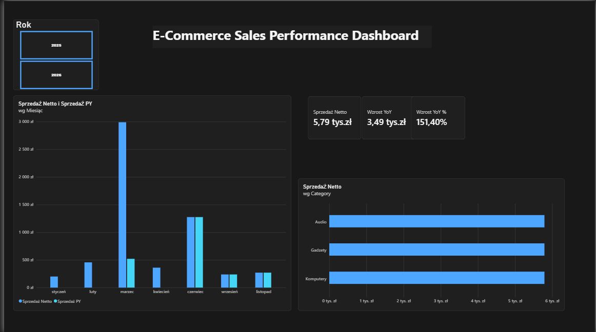

# 📊 E-Commerce Sales Performance Dashboard (SQL Server & Power BI)

## 📌 O projekcie
Kompleksowy projekt analityczny typu **end-to-end** – od zaprojektowania relacyjnej bazy danych i napisania zapytań w **SQL Server**, przez stworzenie modelu danych w schemacie gwiazdy (*Star Schema*), po zbudowanie interaktywnego dashboardu menedżerskiego w **Power BI**.

Dashboard umożliwia zarządowi śledzenie kluczowych wskaźników sprzedaży (KPI), analizę porównawczą rok do roku (**YoY**) oraz ocenę wydajności poszczególnych kategorii produktowych.

---

## 🖼️ Podgląd Dashboardu


---

## 🛠️ Architektura i Technologie
* **Baza Danych:** SQL Server (T-SQL)
* **Modelowanie Danych:** Schemat Gwiazdy (*Star Schema* 1:N)
* **Wizualizacja & Analytics:** Power BI Desktop
* **Język Zapytaniowy DAX:** Funkcje *Time Intelligence* (`TOTALYTD`, `SAMEPERIODLASTYEAR`, `DIVIDE`)

---

## 💻 Zapytania T-SQL (Przykład widoku analitycznego)
```sql
CREATE VIEW vw_Sales_Analysis AS
SELECT 
    fs.SalesID,
    fs.OrderDate,
    fs.ProductID,
    fs.CategoryID,
    fs.NetSalesAmount
FROM Fact_Sales fs;
```

---

## 📈 Kluczowe Wskaźniki i Miary (DAX)
* **Sprzedaż Netto:** `SUM(vw_Sales_Analysis[NetSalesAmount])`
* **Sprzedaż YTD:** `TOTALYTD([Sprzedaż Netto], Dim_Date[Date])`
* **Sprzedaż PY:** `CALCULATE([Sprzedaż Netto], SAMEPERIODLASTYEAR(Dim_Date[Date]))`
* **Wzrost YoY %:** `DIVIDE([Wzrost YoY], [Sprzedaż PY], 0)`

---

## 💡 Kluczowe Wnioski Biznesowe (Insights)
1. **Wzrost YoY:** W marcu 2026 odnotowano skok sprzedaży o **151,40%** w porównaniu do roku poprzedniego.
2. **Kategorie Produktowe:** Największym generatorem przychodu są kategorie *Audio* oraz *Komputery*.
3. **Sezonowość:** Najwyższa dynamika sprzedaży występuje w pierwszym kwartale roku.
